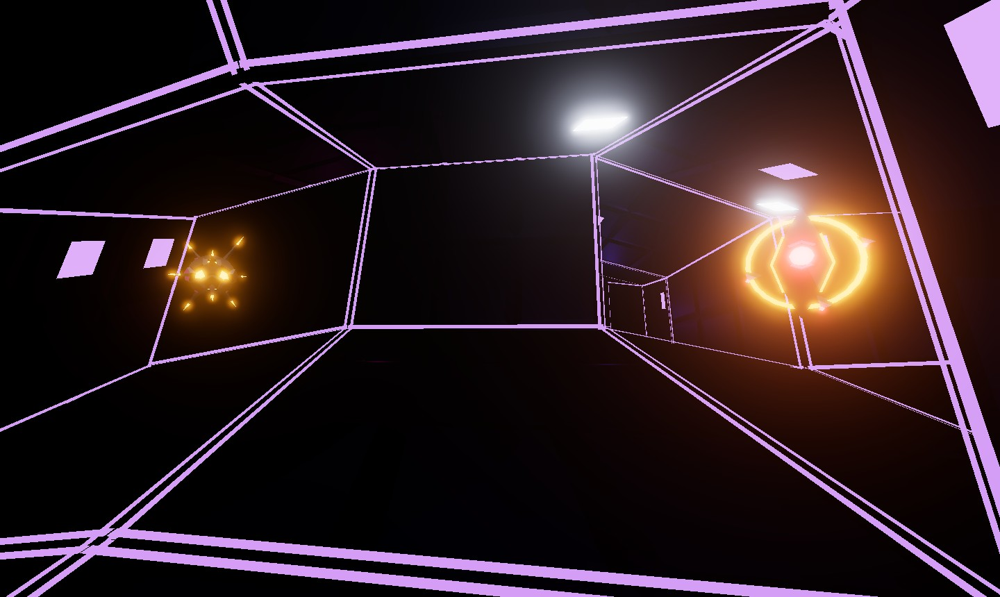
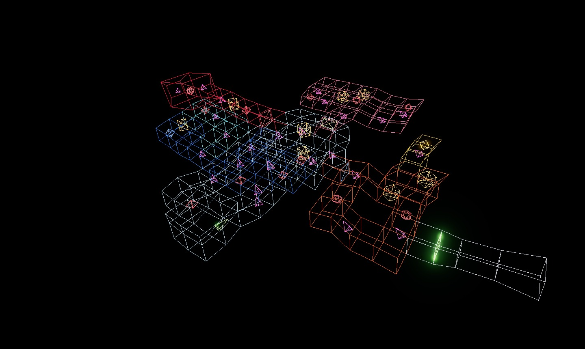

# VOIDSHAFT

*Six degrees of freedom · zero gravity · no way out.*

VOIDSHAFT is a 6DOF tunnel shooter that runs in the browser. You fly a small ship through enclosed mines with no up or down. You fight the robots that guard them and collect the blue, gold and red keys. Then you destroy the reactor and escape through the exit before the mine collapses.

**Play it:** https://brew-your-own.github.io/voidshaft-the-game/



## Origin

The game is a homage to *Descent* (Parallax Software, 1995), the shooter that put players in a ship that moves and turns freely in every direction inside underground mines. VOIDSHAFT keeps that idea and the mine → keys → reactor → escape loop. Everything else is original: the levels, robots, names, art and sound. No *Descent* assets are used.

There are no image or audio files. The look is flat-shaded polygons with emissive LED strips and bloom in a cyberpunk palette. Every sound is synthesised at runtime with WebAudio.

## Features

- Six levels, from a short first mine to the 132-segment Null Spire. Each has its own theme, loops and side branches.
- Three robot types with their own AI: the Stinger dart, the Bulwark gun platform and the Fuse kamikaze mine. The **ENEMIES** screen on the title menu shows each one with its figures.
- Lasers and homing missiles, shields, energy and pickups.
- An in-game automap (Tab), plus a whole-level **map viewer** on the title screen.
- Remappable keys, mouse sensitivity, field of view, and resolution scaling that adapts to slow frames.



## Controls

Mouse to steer, left mouse to fire the laser, right mouse for missiles. Tab opens the map and Esc pauses. The default flight keys are on the **CONTROLS** screen, where you can rebind them.

## Running it locally

You need Node.js 24 or later.

```bash
npm install
npm run dev        # dev server on http://localhost:5173
npm test           # Vitest suites (headless, no WebGL needed)
npm run build      # export levels, typecheck and build into dist/
```

Levels are written in TypeScript under `src/level/levels/` and exported to `public/levels/*.json` by `npm run levels`. [docs/ROADMAP.md](docs/ROADMAP.md) has the design decisions, milestones and known gaps.

## Releases

Pushing a tag that starts with `v` (for example `v0.1.0`) runs `.github/workflows/pages.yml`. It tests and builds the game, then publishes it to GitHub Pages. The title screen shows the build's `git describe`, so a published build shows its tag.

## Tech

[Three.js](https://threejs.org/), [Vite](https://vite.dev/) and TypeScript. Physics and collision are hand-written: the ship is a sphere sliding against the walls of connected eight-vertex cube segments.
